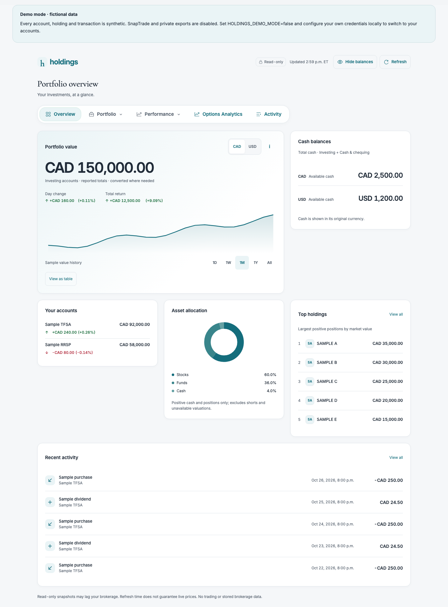
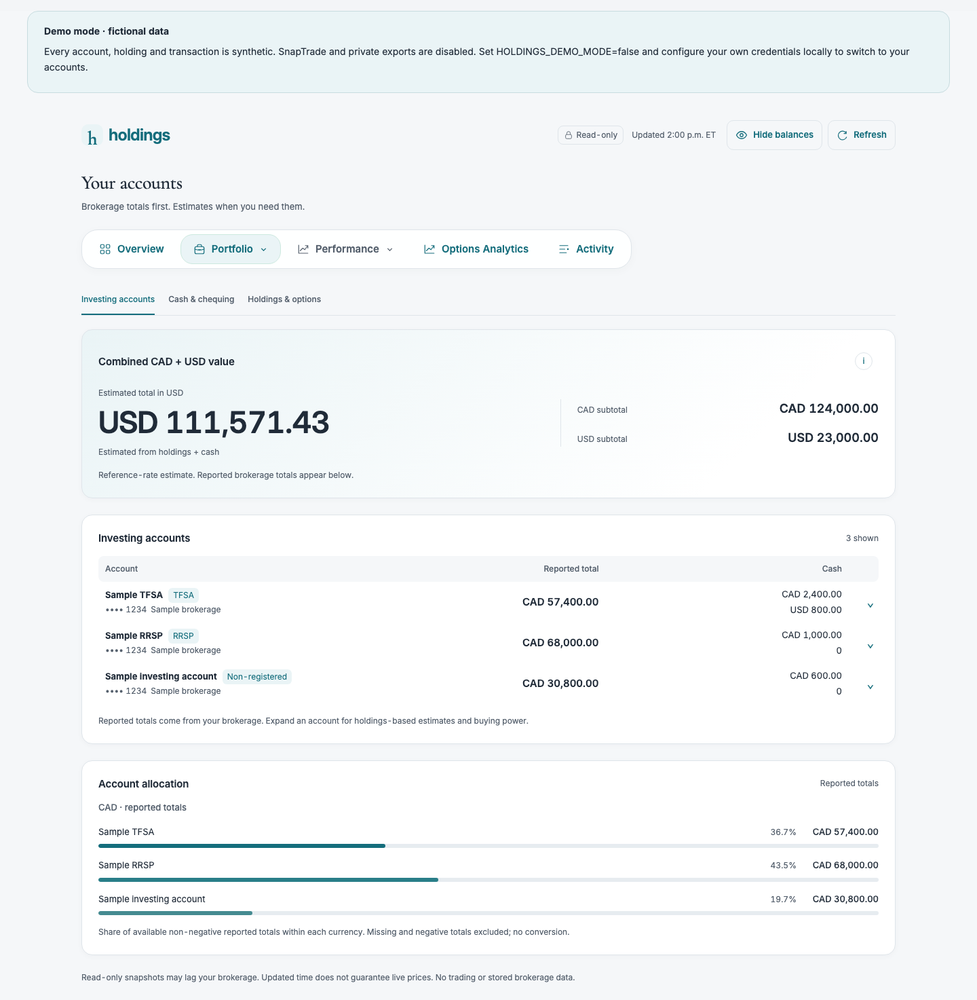
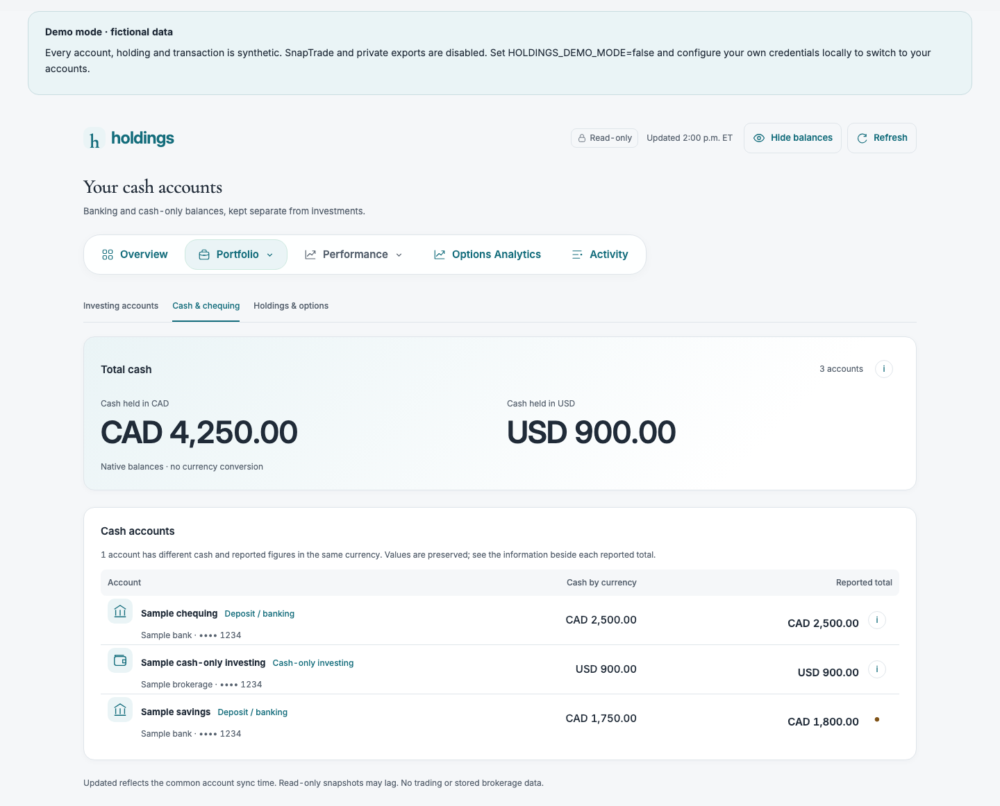
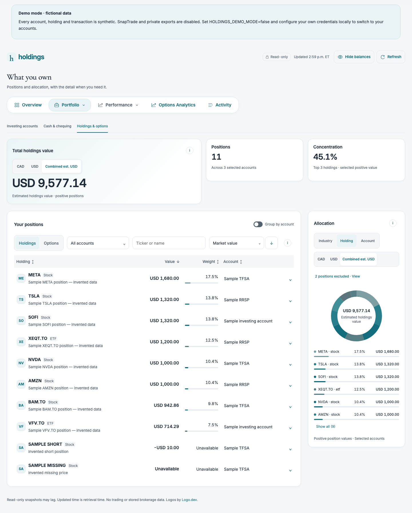
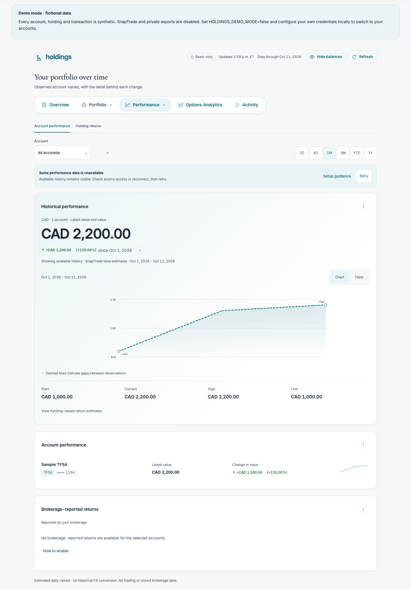
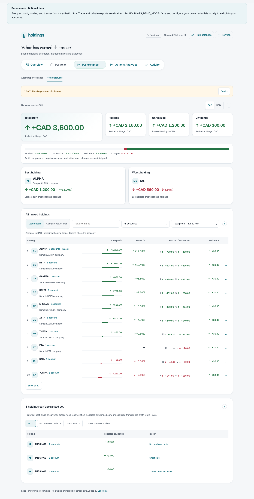
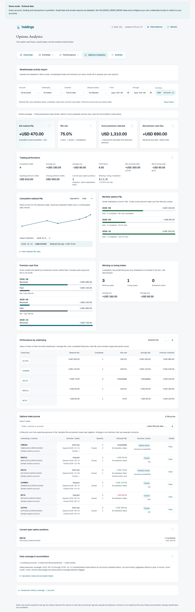
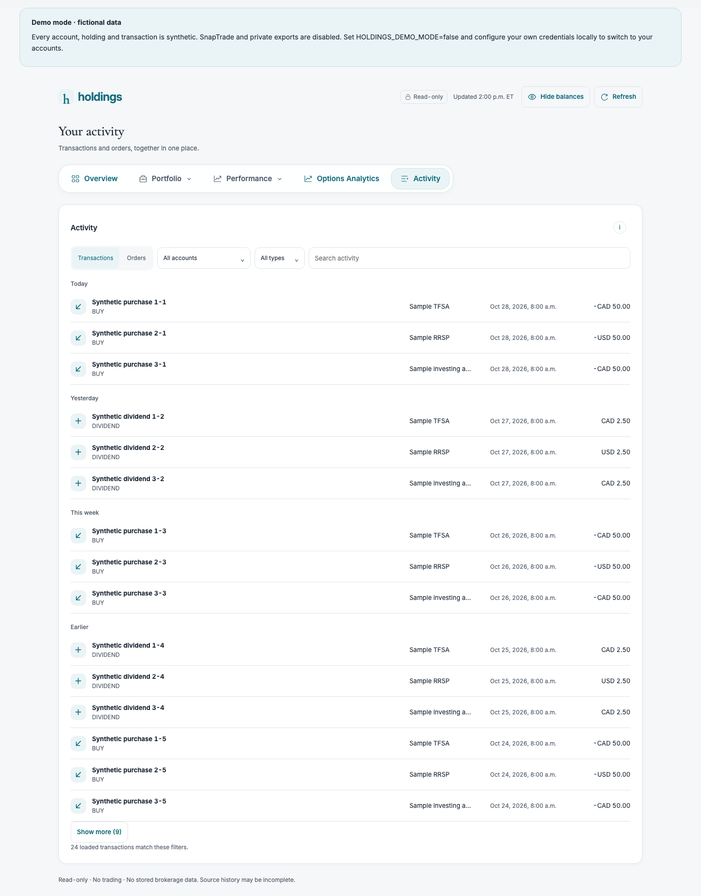

# holdings

A locally hosted, read-only personal investing dashboard built with Next.js App Router, React, TypeScript and SnapTrade Personal. Each installation uses its operator's own credentials and brokerage connections. This is a single-owner local app, not a shared hosted service.

**Runs locally · Read-only brokerage access · Fictional demo included**

[Demo pictures](#demo-pictures) · [Quick start](#quick-start) · [Demo mode](#try-fictional-data-first) · [Configuration](#configuration) · [Security](#privacy-and-security) · [Developer guide](#development-and-verification)

**Release status:** private review. The project license remains pending by the owner's choice. Provider confirmation and other publication gates are recorded in the [readiness assessment](docs/open-source-readiness.md) and [release checklist](docs/release-checklist.md).

## What you can explore

| Page                | Features                                                                                                                           | Local route          |
| ------------------- | ---------------------------------------------------------------------------------------------------------------------------------- | -------------------- |
| Overview            | Reported portfolio values, cash, top holdings, allocation and available history-backed changes.                                    | `/`                  |
| Investing accounts  | Account types, masked suffixes, reported totals, cash/buying power and expandable holdings estimates.                              | `/accounts`          |
| Cash & chequing     | Banking and confirmed cash-only investing accounts, with separate native-currency balances.                                        | `/cash`              |
| Holdings & options  | Search, sorting, account filters, industry/holding/account allocation and available option contract details.                       | `/holdings`          |
| Account performance | Available account-value history, date ranges and deposit-aware return estimates where funding evidence supports them.              | `/performance`       |
| Holding returns     | Realized/unrealized/dividend accounting from available evidence and explanations for unranked holdings.                            | `/returns`           |
| Activity            | Recent orders and transactions. Orders are displayed, never submitted.                                                             | `/activity`          |
| Options Analytics   | Cash-based P&L, quantity-matched lifecycles, premium charts, filters, a trade journal and optional CSV-first Wealthsimple history. | `/options-analytics` |

Shared controls include balance hiding, keyboard navigation, refresh protection, and loading, empty, partial-data and error states. Desktop is the current design priority. The app has no trading, fund-transfer, credential-entry or Commercial user-registration endpoints.

**Available data matters:** historical Greeks/IV, per-stock historical return lines and unsupported settlements are not invented. The Compare return lines controls remain a placeholder until a historical price provider is connected. See [limitations](#limitations).

## Demo pictures

Every picture below was captured from the explicit, credential-free demo using **entirely fictional accounts, holdings and transactions**. No private exports or live portfolio data were loaded. Click an image to view its full resolution; expand a page below to see the rest of the app.

**Portfolio overview** — reported values, available changes, allocation and top holdings.



<details>
<summary>Investing accounts — account balances and reported totals</summary>

The Portfolio page separates brokerage-reported totals from holdings-based estimates and keeps account details expandable.



</details>

<details>
<summary>Cash & chequing — balances by currency</summary>

Banking and confirmed cash-only investing accounts sit outside the investing account list. A personal HYSA label is optional and does not establish a yield.



</details>

<details>
<summary>Holdings & options — positions and allocation</summary>

Search and sort positions, filter by account, and inspect the allocation card. Options expose only the contract details the available evidence supports.



</details>

<details>
<summary>Account performance — your portfolio over time</summary>

Review available account-value history and date ranges, with deposit-aware estimates where funding history is sufficient.



</details>

<details>
<summary>Holding returns — gains, sales and dividends</summary>

The leaderboard ranks supported results and explains which holdings still lack enough evidence. Per-stock historical compare lines are not implemented.



</details>

<details>
<summary>Options Analytics — P&L, premiums and trade lifecycles</summary>

Explore fictional option cash flows, completed trades, charts and the journal. Real CSV uploads are disabled in demo mode.



</details>

<details>
<summary>Activity — recent orders and transactions</summary>

Inspect recent activity without any trading controls. This display feed is separate from the full analytical transaction ledger.



</details>

Capture provenance and regeneration notes are in [docs/images/README.md](docs/images/README.md).

## Requirements

- Node.js **24.x LTS** and npm **11.x**; `.nvmrc` and package engines specify the supported major versions. Keep your Node patch release current.
- Git, a local browser, and access to npm for installation.
- For live mode: your own SnapTrade **Personal** account, Personal client ID and consumer key, and a supported brokerage connected to that account.
- No database, private export or other user's local files are required. Chromium is optional for browser tests/screenshots.

macOS and Linux use the shell commands below. On Windows, use PowerShell for the equivalent copy commands. Native npm dependencies may require platform-specific tooling if a prebuilt binary is unavailable. A clean same-host macOS installation is validated; Windows/Linux clean-machine behavior is not claimed as tested locally.

## Quick start

For a fresh clone, replace `YOUR-USER/YOUR-REPOSITORY` with the repository or fork you intend to use. If you already have an installation, **skip the environment-file copy** to preserve your existing credentials.

```sh
git clone https://github.com/YOUR-USER/YOUR-REPOSITORY.git holdings
cd holdings
nvm install
nvm use
npm ci
cp .env.example .env.local
chmod 600 .env.local
```

If you do not use nvm, install Node 24 and npm 11 separately. In PowerShell, use `Copy-Item .env.example .env.local` instead of `cp`, and restrict access with your Windows file permissions rather than `chmod`. **Do not overwrite an existing `.env.local`.**

Choose one mode in your local editor:

- **Explore the demo:** set `HOLDINGS_DEMO_MODE=true`. Leave the SnapTrade credentials empty; no financial account is needed.
- **Use your own accounts:** leave demo mode off and enter your own `SNAPTRADE_CLIENT_ID` and `SNAPTRADE_CONSUMER_KEY`. See [SnapTrade setup](#snaptrade-personal-setup).

Never paste credentials into chat, issues, screenshots or a browser form. Validate the local configuration and start the app:

```sh
npm run check:config
git check-ignore .env.local
npm run dev
```

Open **http://127.0.0.1:3000**. If the port is occupied, use the local URL printed by Next.js. Both dev and production scripts bind to `127.0.0.1`. The request guard accepts loopback hosts only; this app has no remote authentication. Do not expose it through a tunnel, reverse proxy, LAN binding or public hosting.

For local production use:

```sh
npm run build
npm start
```

Production still reads your local runtime environment; it is not a static site.

## Try fictional data first

In `.env.local`, set:

```dotenv
HOLDINGS_DEMO_MODE=true
```

Then run `npm run check:config` and `npm run dev`, or restart an already running server. Credentials are unnecessary in this mode. All eight pages use existing synthetic view models, including holdings, cash, options, transactions and performance. Demo mode skips SnapTrade, local CSV reads, external logo URLs and Bank of Canada requests. CSV uploads are disabled so real exports cannot be mixed into demo data.

The fictional options fixture explicitly exercises the optional USD policy; live installations default to reported currencies. Set the flag back to `false` and restart to use your accounts. Live request failures never fall back to invented data. Development-only `?preview=sample` and other documented preview states remain available; production ignores those query parameters unless explicit demo mode is enabled.

## SnapTrade Personal setup

1. Create/sign in to your own [SnapTrade Personal account](https://dashboard.snaptrade.com/).
2. Connect your own supported brokerage using SnapTrade's dashboard/Connection Portal. Choose read-only permissions where offered. This app does not generate portal URLs or request trading access.
3. Obtain your own Personal API `clientId` and `consumerKey` from SnapTrade and save them in `.env.local`.
4. Restart holdings. It retrieves the accounts associated with that Personal key.

The installed SDK is initialized only in `src/server/snaptrade.ts`, using `SnaptradeAuth.personalApiKey({ clientId, consumerKey })`. Requests omit Commercial `userId` and `userSecret`; the app never registers a SnapTrade user. This matches the [official Personal integration model](https://docs.snaptrade.com/docs/personal-vs-commercial) and [personal app guide](https://docs.snaptrade.com/docs/build-with-ai).

Each person runs an independent copy with their own key. Sharing a hosted installation is a different product model. SnapTrade's guidance recommends OAuth when an app connects other Personal users; confirm that distribution of independently operated local copies is permitted for your intended launch. See [provider and license checks](docs/third-party-notices.md).

## Configuration

All names are in `.env.example`; it contains no credentials. Empty optional variables use the defaults below. Restart after changing settings.

| Variable                     | Purpose / default                                                                                                                                         |
| ---------------------------- | --------------------------------------------------------------------------------------------------------------------------------------------------------- |
| `SNAPTRADE_CLIENT_ID`        | Required in live mode: your own Personal client ID. Server only.                                                                                          |
| `SNAPTRADE_CONSUMER_KEY`     | Required in live mode: your own Personal consumer key. Server only.                                                                                       |
| `HOLDINGS_DEMO_MODE`         | Optional `true`/`false`; default `false`. Fictional data only when enabled.                                                                               |
| `HOLDINGS_OPTIONS_CURRENCY`  | Optional `reported`/`USD`; default `reported`. `USD` explicitly relabels option amounts without FX conversion; it is not appropriate for every brokerage. |
| `HOLDINGS_CASH_ONLY_AS_HYSA` | Optional `true`/`false`; default `false`. Personal display label only, not proof of account type, APY or higher yield.                                    |
| `LOGO_DEV_PUBLISHABLE_KEY`   | Optional Logo.dev `pk_` key. Empty disables logo requests. Never enter an `sk_` key. The publishable key is intentionally included in image URLs.         |

`npm run check:config` validates local settings without printing values or calling SnapTrade. It does not verify whether a key is accepted by the provider. Do not use `NEXT_PUBLIC_SNAPTRADE*` variables. Brokerages other than Wealthsimple can supply the supported SnapTrade fields, but feature coverage varies; there is no claim that every brokerage has been live-tested.

## CSV imports

**Options Analytics → Import Wealthsimple activity** accepts drag-and-drop or file selection. Use an activity export, not a realized gain/loss report. Limits: 20 files, 10 MB total and 20,000 rows. A successful batch replaces the previous upload; include every file you want to analyze.

The CSV is the primary historical ledger. API fills are not appended, even outside the export dates. SnapTrade current positions remain separate; CSV account aliases are not automatically linked to them. Missing fees, openings and settlement evidence stay unavailable. All monetary calculations retain exact decimal inputs before display rounding.

Uploads are processed temporarily by the local app and returned to the current page's memory. They are not saved to disk or Git; full reload clears them. **Remove uploaded CSV** restores the original source. Failed uploads keep your previous view. Uploads do not alter Holding Returns.

For persistent local imports, optionally create `private-data/wealthsimple/` outside `public/` and place your activity exports there. That git-ignored folder also supports the existing corroborated Holding Returns reconciliation. Removing a file removes its contribution on the next load. See [private imports](docs/private-imports.md) and [CSV methodology](docs/csv-reconciliation.md).

## Privacy and security

- SnapTrade credentials stay in server-side environment variables. They are not sent to client JavaScript. A Personal key may authorize trading elsewhere; protect it even though holdings exposes read methods only.
- Data is not intentionally sent to the repository maintainer. Live mode contacts SnapTrade and, for CAD/USD estimates, the Bank of Canada. Optional Logo.dev image requests disclose requested ticker symbols and network information to that provider. No external logos are requested without a publishable key.
- Fonts are installed and served locally. No Google Fonts runtime request is required. `NEXT_TELEMETRY_DISABLED=1` disables Next.js framework telemetry when desired.
- Brokerage history is reused in bounded process memory (typically 60 seconds, shorter for partial reads), with credential/account scoping and no disk archive. Process loss clears these caches.
- Files you choose to keep in `private-data/wealthsimple/` remain on disk. The browser privacy toggle stores a `balances-hidden` preference cookie; it hides display values, not network payloads or developer tools.
- Optional screenshot tooling writes screenshots and saved browser state to ignored locations. These are sensitive local artifacts, not suitable for automatic publication. Only synthetic screenshots belong in public documentation.
- `.env.local`, private exports, generated output, local databases and screenshot/auth artifacts are ignored. Ignore rules do not remove already committed history or prevent force-add.

Read [SECURITY.md](SECURITY.md), [security and data boundaries](docs/security-and-data.md), and the [readiness assessment](docs/open-source-readiness.md). Secret scanners reduce risk; they do not prove every file is safe.

## Limitations

Brokerage/API fields, synchronization, historical coverage and permissions differ. Available pages do not prove complete lifetime history. Account-value history can have a shorter window than transaction history; missing valuation points are not reconstructed from today's portfolio. Recent activity is a deliberately limited display feed, not the full analytical ledger.

Reported account totals and estimated holdings values have different scopes and timestamps and can differ legitimately. CAD/USD conversions use Bank of Canada daily reference rates, not live brokerage quotes or execution FX; historical conversions are labelled estimates. Other native currencies are retained where supplied but CAD/USD aggregate views are limited to those currencies.

Account classification relies on explicit provider categories and confirmed empty positions; it does not infer banking status from a failed positions request. Zero CAD/USD accounts are hidden in current views but retained in history scope. Industry labels are app-maintained, not official GICS; ETFs are not looked through. A narrowly documented CAD trust valuation exception remains in normalization.

Historical Greeks, entry IV, historical stock return lines, automatic options strategy detection, verified assignment/exercise P&L, and missing basis/fees are not manufactured. Missing per-share CSV quote conventions can leave entry/exit prices unavailable even where signed cash supports trade estimates.

## Troubleshooting

| Problem                          | What to check                                                                                                                                                                        |
| -------------------------------- | ------------------------------------------------------------------------------------------------------------------------------------------------------------------------------------ |
| Setup banner / missing variables | Create `.env.local` from the template, enter your own keys locally, run `npm run check:config`, restart. Or explicitly enable demo.                                                  |
| Invalid credentials / 401 or 403 | Use Personal keys, not Commercial user credentials. Check values and permissions privately in SnapTrade, then restart. No value is printed by the setup utility.                     |
| No accounts or holdings          | Connect your own brokerage in SnapTrade; allow its sync to complete. Check Cash & chequing and hidden zero-balance filters. Empty is different from a failed request.                |
| Disabled connection              | Reconnect in SnapTrade, then refresh once. Existing snapshots may be stale.                                                                                                          |
| 429 / refresh unavailable        | Respect the cooldown. Reads are deduplicated and concurrency-limited; repeated refreshes do not force a brokerage synchronization.                                                   |
| Unsupported history/fields       | Check provider capabilities and coverage notes. Unavailable data remains unavailable; use supported CSV evidence where appropriate.                                                  |
| CSV rejected                     | Use Wealthsimple activity columns, valid CSV quoting, complete account IDs and limits above. Other brokerage/gain-loss schemas are not supported by this importer.                   |
| Logos missing                    | Leave the optional key empty for initials, or use your own valid publishable `pk_` key. Preserve Logo.dev attribution.                                                               |
| Install/build errors             | Use Node 24/npm 11, keep the lockfile, run `npm ci` with registry access. Install platform dependencies if prebuilt binaries are unavailable. Do not share `.env.local` or raw logs. |
| Local request rejected           | Use the loopback URL printed by Next.js, with the same scheme/host/port. Cross-origin access and remote hostnames are deliberately blocked.                                          |

## Development and verification

```sh
npm run lint
npm run typecheck
npm test
npm run format:check
npm run build
npm run check:distribution
```

Unit tests use synthetic fixtures and explicitly ignore live environment credentials. GitHub Actions runs installation, configuration validation, lint, types, unit tests, build and the redacted distribution scan without financial credentials. Browser checks are optional:

```sh
npx playwright install chromium
npm run test:browser -- --project=desktop
```

Useful commands:

| Command                                     | Purpose                                                                                      |
| ------------------------------------------- | -------------------------------------------------------------------------------------------- |
| `npm run dev`                               | Start the local development server.                                                          |
| `npm run check:config`                      | Validate local settings without printing keys or contacting SnapTrade.                       |
| `npm test`                                  | Run synthetic unit/regression tests.                                                         |
| `npm run test:browser -- --project=desktop` | Run desktop Playwright checks; install Chromium first.                                       |
| `npm run screenshots`                       | Capture a quick UI review, at most ten images per run, in the ignored `screenshots/` folder. |
| `npm run build` / `npm start`               | Build and serve the local production app.                                                    |
| `npm run check:distribution`                | Scan source, reachable history, bundles and deployment traces with redacted output.          |
| `npm run release:export -- --review`        | Export a clean committed source snapshot for private review without its Git history.         |

The committed documentation gallery is separate from the ignored screenshot-tool output. Only independently fictional captures may be copied into `docs/images/`. See [capture tooling](screenshots-tool/README.md) for its privacy controls and synthetic-only capture mode.

For code navigation, start with [the project guide](docs/project-guide.md). Other references:

- [Contribution guide](CONTRIBUTING.md) and [security reporting](SECURITY.md).
- [Options methodology](docs/options-analytics.md) and [CSV source policy](docs/csv-reconciliation.md).
- [Private import instructions](docs/private-imports.md) and [security/data boundaries](docs/security-and-data.md).
- [Release checklist](docs/release-checklist.md) and [third-party notices](docs/third-party-notices.md).

## Prepare a source-only snapshot

After committing a reviewed, clean tree, `npm run release:export` creates an ignored source archive without `.git`, history, credentials, private exports or generated artifacts. A committed project license is required. While license approval is pending, `npm run release:export -- --review` creates a **private review-only** snapshot. Neither command publishes anything. Use a separate new repository for a fresh public history after the [release checklist](docs/release-checklist.md) is complete; do not expose this repository's older private audit summaries.

## License and disclaimer

**No project license has been selected or granted yet.** MIT is recommended for consideration; it will only be applied after the owner's approval. Public visibility alone does not make this an open-source licensed project. Dependency/font licenses remain in force; see [third-party notices](docs/third-party-notices.md).

holdings is an independent analytics project, not officially affiliated with or endorsed by SnapTrade, Wealthsimple, Logo.dev or any brokerage. It provides informational estimates, not investment, tax or legal advice. Verify figures with your brokerage before relying on them.
